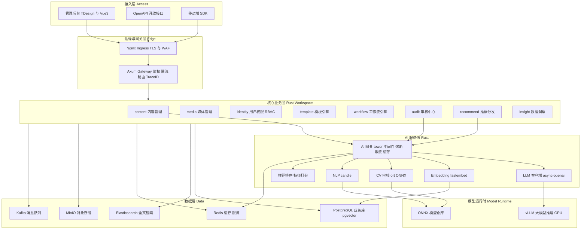
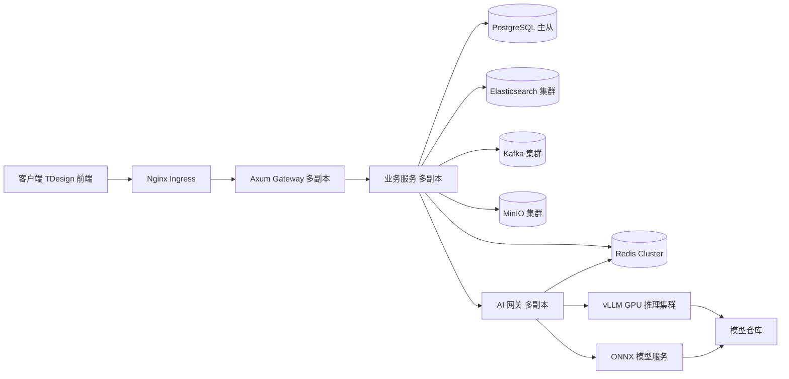
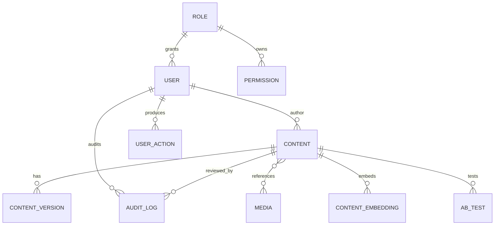
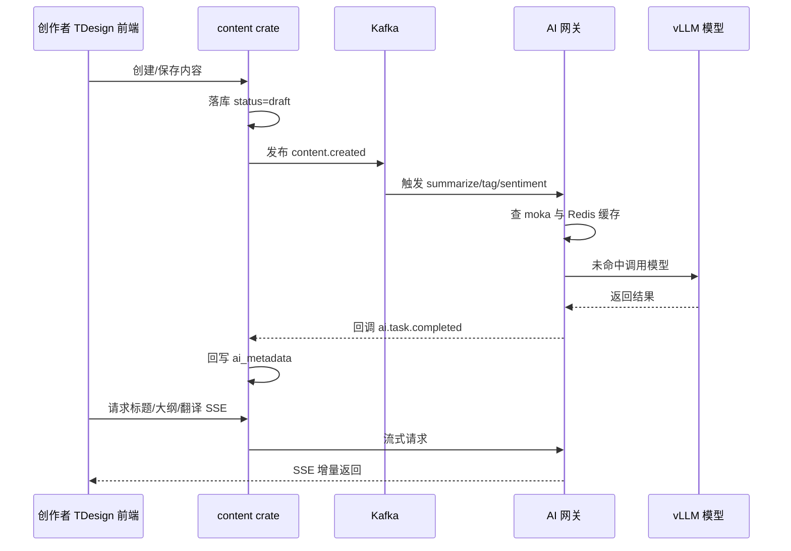
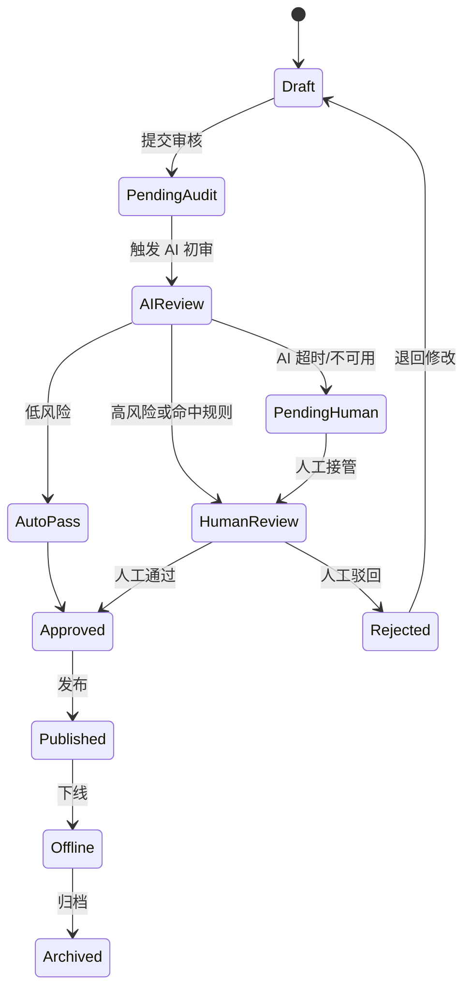
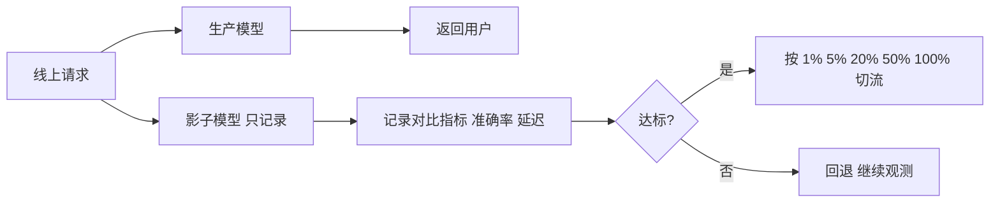

# 智能内容管理系统（AI-CMS）技术方案设计

Feature Name: intelligent-cms
Updated: 2026-11-26

## 1. 描述

本方案面向智能内容管理系统（ICMS）的落地实施，覆盖内容生产、审核、分发、洞察四大业务域，以及支撑它们的 AI 服务层、数据层与基础设施层。方案在传统 CMS 的内容管理与 RBAC 能力之上，通过统一 AI 网关封装 LLM、NLP、CV 与推荐能力，并以“AI 初审 + 人工复审”的人机协同机制保证内容合规，以“影子模式 + 灰度放量”保证模型与功能演进的安全可控。

技术栈采用 **Rust（Axum + Tokio）+ TDesign（Vue 3）** 组合：后端以 Rust 提供内存安全、低延迟、高并发的服务能力，前端以 TDesign 设计体系构建管理后台与运营界面。

设计目标如下：

- **业务完整性**：覆盖需求文档第 3 章全部核心功能模块。
- **可扩展性**：以 Cargo Workspace 划分领域 crate，AI 能力、模型、数据源以 trait 抽象与插件化方式接入，新增能力无需改动业务主干。
- **高可用**：核心服务 SLA ≥ 99.9%，AI 能力具备超时、熔断、缓存、降级四重保护。
- **高性能**：借助 Rust 零成本抽象与 Tokio 异步运行时，降低内存占用与尾延迟，减少副本数量与资源成本。
- **可观测性**：tracing 全链路 TraceID 贯通，指标、日志、告警三位一体。
- **可演进**：Prompt 版本化、模型灰度、数据结构预留扩展字段，支撑长期迭代。

## 2. 设计决策

下表列出关键技术决策及其理由，作为后续实现与评审的基线。

| 决策项 | 选型 | 理由 |
|--------|------|------|
| 后端语言 | Rust（edition 2021） | 内存安全、无 GC 停顿、低尾延迟，适合高并发内容读写与网关转发 |
| 异步运行时 | Tokio | 事实标准异步运行时，生态完整，配合多线程工作窃取调度 |
| Web 框架 | Axum 0.8 | 基于 Tower 服务抽象，中间件组合能力强，原生支持 SSE 与 WebSocket |
| 中间件 | Tower / tower-http | 统一实现超时、限流、追踪、压缩、CORS、请求体限制 |
| 限流 | governor | 基于 GCRA 算法的令牌桶限流，支持按租户与接口维度 |
| 熔断 | tower-resilience / failsafe | 熔断器与重试策略以中间件层实现，与 AI 网关解耦 |
| 本地缓存 | moka | 高性能并发缓存，支持 TTL 与容量淘汰，作为 AI 结果一级缓存 |
| 分布式缓存 | Redis 7（deadpool-redis 连接池） | 热点数据、Session、限流计数、AI 结果二级缓存 |
| 关系型数据库 | PostgreSQL 16 | 支持 JSONB 存储 AI 元数据，配合 pgvector 做向量检索 |
| 数据访问 | SeaORM（基于 sqlx） | 实体建模与迁移完善，复杂查询回退 sqlx 类型安全 SQL |
| 迁移工具 | sea-orm-migration | 版本化 DDL 迁移，与 CI 集成 |
| 向量检索 | 默认 pgvector，规模化后切换 Qdrant | Qdrant 为 Rust 原生向量库，超千万级向量时迁移成本低 |
| 全文检索 | Elasticsearch 8（elasticsearch crate） | 中文分词、聚合分析、内容检索能力强 |
| 消息队列 | Kafka（rdkafka） | 行为埋点、审核事件、AI 异步任务的高吞吐管道 |
| 对象存储 | MinIO / OSS（aws-sdk-s3） | S3 兼容协议，预签名直传，便于多云切换 |
| 异步任务 | 自研 Worker + 死信表 + rdkafka 消费组 | 复用 Rust 运行时，避免多语言任务队列，重试与死信可控 |
| LLM 调用 | async-openai 对接 vLLM / 云厂商 OpenAI 兼容接口 | 统一 OpenAI 协议，模型可替换，支持流式 |
| 本地推理 | candle（NLP）/ ort（ONNX Runtime，CV）/ fastembed（Embedding） | 纯 Rust 侧完成向量化与轻量推理，降低跨语言开销 |
| 序列化 | serde / serde_json | 全链路统一序列化，零拷贝反序列化 |
| 接口文档 | utoipa | 从代码生成 OpenAPI 3.0，避免文档与实现漂移 |
| 鉴权 | jsonwebtoken + axum 提取器 | JWT 无状态鉴权，配合 Redis 维护黑名单与刷新令牌 |
| 可观测 | tracing + opentelemetry-otlp + metrics-exporter-prometheus | 标准协议，指标/日志/链路统一采集 |
| 前端框架 | Vue 3 + TypeScript + Vite | 组合式 API 提升可维护性，Vite 构建快 |
| 前端组件库 | TDesign Vue Next | 腾讯 TDesign 设计体系，管理后台组件完备，主题可定制 |
| 前端状态 | Pinia + Vue Router | 官方推荐状态与路由方案 |
| 图表 | ECharts | 数据洞察看板可视化 |
| 构建 | Cargo Workspace + cargo-chef | 多 crate 管理，分层缓存加速镜像构建 |
| 部署 | Docker（distroless）+ Kubernetes + Nginx Ingress | 多可用区高可用，支持 HPA 与灰度 |

> 决策说明：AI 推理的模型运行时（如 LLM 的 vLLM、CV 的大模型）仍以独立模型服务形式部署并由 Rust 服务经 HTTP/gRPC 调用，这是业界通用做法；除模型运行时外，网关、业务、任务编排均以 Rust 实现，保持单一主力语言与统一工具链。前端 TDesign 同时提供 React 版本，若团队偏好 React 可平替为 TDesign React，接口契约与后端不变。

## 3. 总体架构

### 3.1 分层架构



### 3.2 架构说明

- **接入层**：管理后台基于 TDesign Vue Next 构建，面向运营与审核人员；OpenAPI 面向第三方系统集成；移动端 SDK 面向 C 端内容消费与埋点上报。
- **边缘与网关层**：Nginx Ingress 负责 TLS 终止与基础防护；Axum Gateway 基于 Tower 中间件实现 JWT 鉴权、governor 令牌桶限流、路由转发、TraceID 注入与请求日志。
- **核心业务层**：以领域驱动划分 Cargo crate，内容、媒体、权限、模板、工作流、审核、推荐、洞察各自独立，通过领域事件与 Kafka 解耦。业务以模块化单体（modular monolith）方式组织为可组合的 workspace，通过 feature 与 crate 边界保证可拆分性。
- **AI 服务层**：AI 网关作为唯一出口，基于 Tower 中间件提供路由、熔断、缓存（moka + Redis）、限流、降级与计量；具体能力由 async-openai、fastembed、ort、candle 等 crate 实现。
- **模型运行时**：vLLM 提供 OpenAI 兼容的大模型推理端点，ONNX 模型仓库承载 CV/NLP 模型，二者独立扩缩容，与业务服务生命周期解耦。
- **数据层**：多模存储按访问特征分工，结构化数据入 PostgreSQL，检索入 Elasticsearch，热点与限流入 Redis，多媒体入对象存储，事件入 Kafka。

### 3.3 部署拓扑



## 4. 组件与接口设计

### 4.1 工程结构与服务划分

后端采用 Cargo Workspace 组织，crate 边界即服务边界，便于按需拆分为独立部署单元。

```text
icms/
├── Cargo.toml                 # workspace 根
├── crates/
│   ├── icms-api/              # 对外 HTTP 入口（组合业务 crate）
│   ├── icms-gateway/          # 网关中间件：鉴权/限流/熔断/追踪
│   ├── icms-content/          # 内容领域：CRUD/版本/状态机
│   ├── icms-media/            # 媒体领域：上传/转码/元数据
│   ├── icms-identity/         # 身份领域：用户/角色/权限/二次验证
│   ├── icms-workflow/         # 工作流：审核流/发布流/审批节点
│   ├── icms-audit/            # 审核：AI 初审编排/人工复审/反哺
│   ├── icms-recommend/        # 推荐：画像/召回/排序/AB
│   ├── icms-insight/          # 洞察：归因/趋势/异常
│   ├── icms-ai-gateway/       # AI 网关：路由/熔断/缓存/计量
│   ├── icms-ai-llm/           # LLM 客户端封装（async-openai）
│   ├── icms-ai-embedding/     # 向量化（fastembed）
│   ├── icms-ai-cv/            # CV 审核（ort）
│   ├── icms-ai-nlp/           # NLP（candle）
│   ├── icms-worker/           # 异步任务消费者
│   └── icms-common/           # 共享：错误/分页/观测/配置
├── migrations/                # sea-orm-migration DDL
└── web/                       # TDesign Vue 3 前端
```

| 服务单元 | 职责 | 关键 Crate | 副本策略 |
|----------|------|------------|----------|
| icms-api | 对外 HTTP 入口、路由聚合、OpenAPI | axum、tower-http、utoipa | 3+，HPA |
| icms-gateway | 鉴权、限流、熔断、TraceID、请求日志 | tower、governor、tower-resilience、tracing | 3+，HPA |
| icms-content | 内容 CRUD、版本、状态机 | axum、sea-orm、sqlx | 3+，HPA |
| icms-media | 媒体上传、转码、元数据 | axum、aws-sdk-s3、ffmpeg 调用 | 2+ |
| icms-identity | 用户、角色、权限、二次验证 | axum、jsonwebtoken、sea-orm | 2+ |
| icms-workflow | 审核流、发布流、审批节点 | axum、sea-orm、rdkafka | 2+ |
| icms-audit | AI 初审编排、人工复审、结果反哺 | axum、rdkafka、sea-orm | 2+ |
| icms-recommend | 画像、召回、排序、A/B | axum、moka、elasticsearch | 3+，HPA |
| icms-insight | 归因、趋势、异常监控 | axum、rdkafka、clickhouse 客户端 | 2+ |
| icms-ai-gateway | AI 能力路由、熔断、缓存、计量 | axum、tower-resilience、moka、deadpool-redis | 3+，HPA |
| icms-ai-llm | LLM 创作、翻译、摘要、RAG、流式 | async-openai、tokio-stream | 按 GPU 网关 |
| icms-ai-embedding | 向量化、语义检索 | fastembed、pgvector | 2+ |
| icms-ai-cv | 图像/视频审核、画质增强 | ort、image、ffmpeg | 按 GPU 池 |
| icms-ai-nlp | 分词、关键词、情感、合规 | candle、tokenizers | 2+ |

### 4.2 核心 REST 接口

统一前缀 `/api/v1`，采用 RESTful 风格，返回统一响应结构，接口文档由 utoipa 从代码生成 OpenAPI 3.0。

```json
{
  "code": 0,
  "message": "ok",
  "traceId": "4bf92f3577b34da6",
  "data": {}
}
```

| 方法 | 路径 | 说明 | 权限 |
|------|------|------|------|
| POST | /contents | 创建内容 | content:write |
| PUT | /contents/{id} | 更新内容（乐观锁） | content:write |
| POST | /contents/{id}/publish | 发布内容 | content:publish |
| GET | /contents | 内容检索（分页、组合条件） | content:read |
| GET | /contents/{id}/versions | 版本列表 | content:read |
| POST | /contents/{id}/rollback | 版本回滚 | content:write |
| POST | /media | 上传媒体（直传预签名） | media:write |
| POST | /audits | 提交审核 | audit:write |
| POST | /audits/{id}/review | 人工复审 | audit:review |
| POST | /ai/analyze | 内容分析（异步） | ai:invoke |
| GET | /ai/tasks/{requestId} | 查询 AI 任务结果 | ai:invoke |
| GET | /ai/stream | 流式生成（SSE） | ai:invoke |
| GET | /recommend/feed | 场景化推荐 | public |
| POST | /abtests | 创建 A/B 实验 | ops:write |
| GET | /insights/attribution | 效果归因 | insight:read |

### 4.3 Axum 路由与中间件装配

业务入口以 Axum Router 组合，中间件按洋葱模型自外向内装配。

```rust
// crates/icms-api/src/main.rs（示意）
use axum::{routing::{get, post}, Router};
use tower_http::trace::TraceLayer;
use tower_http::timeout::TimeoutLayer;
use std::time::Duration;

let app = Router::new()
    .route("/api/v1/ai/analyze", post(ai::analyze))
    .route("/api/v1/ai/stream", get(ai::stream_sse))
    .route("/api/v1/contents", get(content::list).post(content::create))
    .layer(TimeoutLayer::new(Duration::from_secs(3)))
    .layer(gateway::rate_limit())      // governor 令牌桶
    .layer(gateway::auth())            // JWT 提取器
    .layer(TraceLayer::new_for_http());
```

### 4.4 AI 网关接口契约

AI 分析采用异步任务 + 轮询/回调，长文本生成采用 SSE 流式。

**异步分析请求**

```http
POST /api/v1/ai/analyze
Content-Type: application/json
X-Trace-Id: 4bf92f3577b34da6

{
  "content_id": "12345",
  "tasks": ["summarize", "tag", "sentiment", "moderate"],
  "priority": "normal",
  "callback_url": "https://biz.internal/callback/ai"
}
```

**异步分析响应**

```json
{
  "request_id": "req-9f1c2d3e",
  "status": "processing",
  "estimated_time": 2.5
}
```

**SSE 流式响应（axum::response::sse::Sse）**

```http
GET /api/v1/ai/stream?task=outline&content_id=12345
Accept: text/event-stream
```

```text
event: delta
data: {"text":"第一部分"}

event: delta
data: {"text":"：背景与目标"}

event: done
data: {"request_id":"req-9f1c2d3e","tokens_in":320,"tokens_out":180}
```

**网关内部处理链**：鉴权 → 幂等校验（request_id）→ moka 本地缓存 → Redis 分布式缓存 → 路由选择（模型/版本）→ governor 限流 → 调用模型运行时 → 计量记账 → 熔断统计（tower-resilience）→ 结果落库与回调。

### 4.5 领域事件

通过 Kafka 解耦业务与 AI，主题规划如下：

| Topic | 生产者 | 消费者 | 用途 |
|-------|--------|--------|------|
| content.created | content | ai-nlp、ai-embedding | 触发摘要、打标、向量化 |
| content.updated | content | es-sync、ai-embedding | 检索同步、向量更新 |
| audit.requested | workflow | audit | 发起 AI 初审 |
| audit.completed | audit | workflow | 审核结果驱动状态流转 |
| user.action | 接入层 | recommend、insight | 行为埋点、画像更新 |
| ai.task.completed | ai-gateway | content | AI 结果回写 |

## 5. 数据模型

### 5.1 实体关系



### 5.2 核心表结构

**content（内容表）**

| 字段 | 类型 | 说明 |
|------|------|------|
| id | bigint PK | 雪花 ID |
| title | varchar(512) | 标题 |
| body | text | 正文（富文本/JSON） |
| summary | text | AI 摘要 |
| tags | varchar[] / jsonb | 标签 |
| status | varchar(32) | 状态机 |
| author_id | bigint | 作者 |
| ai_metadata | jsonb | 模型版本、Token、置信度、Embedding 引用 |
| ext_config | jsonb | 业务线扩展配置 |
| version | int | 乐观锁版本 |
| publish_time | timestamptz | 发布时间 |
| created_at | timestamptz | 创建时间 |
| updated_at | timestamptz | 更新时间 |

**content_version（版本表）**：id、content_id、version、snapshot(jsonb)、operator_id、created_at。

**media（媒体表）**：id、url、type(image/video/audio)、ai_tags(jsonb)、hash(sha256)、size、duration、upload_time。

**user_action（行为表，异步落 ClickHouse/ES）**：user_id、content_id、action_type(click/stay/convert)、duration、device、geo、timestamp。

**audit_log（审核日志）**：id、content_id、ai_result(jsonb)、human_result(jsonb)、risk_score、auditor_id、audit_time、model_version。

**content_embedding（向量表）**：content_id、model_version、embedding(vector(1536))、updated_at，配合 pgvector 的 hnsw 索引。

**ab_test（实验表）**：id、content_id、variant(A/B/C)、traffic_ratio、metrics(jsonb)、status、created_at。

**sys_user / sys_role / sys_permission / sys_user_role / sys_role_permission**：RBAC 五表模型。

### 5.3 SeaORM 实体示例

```rust
// crates/icms-content/src/entity/content.rs（示意）
use sea_orm::entity::prelude::*;

#[derive(Clone, Debug, DeriveEntityModel)]
#[sea_orm(table_name = "content")]
pub struct Model {
    #[sea_orm(primary_key)]
    pub id: i64,
    pub title: String,
    pub body: String,
    pub summary: Option<String>,
    pub status: String,
    #[sea_orm(column_type = "JsonBinary")]
    pub ai_metadata: Option<Json>,
    pub author_id: i64,
    pub version: i32,
    pub publish_time: Option<DateTimeUtc>,
}

#[derive(Copy, Clone, Debug, EnumIter, DeriveRelation)]
pub enum Relation {}
impl ActiveModelBehavior for ActiveModel {}
```

### 5.4 索引与扩展设计

- `content(status, publish_time desc)` 支撑发布流与列表；`content(author_id, created_at desc)` 支撑作者视图。
- `tags` 采用 GIN 索引；`ai_metadata` 采用 jsonb GIN 索引支撑按模型版本过滤。
- 向量列建立 HNSW 索引，检索返回 top-k 后由业务做重排。
- 非结构化 AI 结果统一落在 `ai_metadata`，通过 `model_version` 字段支持多版本共存与回刷。
- 所有业务表预留 `ext_config jsonb`，避免高频 DDL 变更。

## 6. 核心流程设计

### 6.1 智能内容生产流程



### 6.2 人机协同审核流程



**规则说明**

- AI 初审输出分项风险分与命中证据，风险分低于阈值且无高风险命中时自动通过。
- 命中高风险、AI 超时或服务降级时，内容进入 `PendingHuman`，禁止自动发布。
- 人工复审结论与 AI 结论一并落 `audit_log`，差异样本进入模型优化数据集。

### 6.3 推荐与 A/B 测试流程

1. **召回**：基于用户画像标签从 Elasticsearch 与向量库多路召回候选集。
2. **排序**：icms-recommend 结合时间、设备、地理位置、意图特征打分。
3. **重排**：做多样性与打散，避免同质内容聚集。
4. **A/B 分配**：按 `hash(user_id + experiment_id) % 100` 落在流量区间，保证同一用户版本稳定。
5. **择优**：达到样本量与显著性阈值后自动给出胜出版本，支持一键切流。

### 6.4 灰度与影子发布流程



## 7. 正确性属性

以下不变量作为实现与测试的约束：

1. **状态机安全**：内容状态迁移仅允许图中定义的有向边，非法迁移被拒绝。
2. **双重审核完整性**：任何状态为 `Published` 的内容必然存在 AI 结论与人工结论的完整记录。
3. **乐观锁一致**：并发更新时，版本号不匹配的写入必须失败，不产生丢失更新。
4. **幂等性**：AI 分析以 `request_id` 保证幂等，重复提交返回同一结果。
5. **缓存一致性**：内容更新后，相关 AI 缓存与向量在可见时间内失效或重建。
6. **A/B 稳定性**：同一用户在实验周期内始终命中同一版本。
7. **审计不可篡改**：审计日志只追加，不支持更新与删除。
8. **脱敏约束**：行为数据入库前完成 PII 脱敏，原始标识不可逆推。
9. **内存安全**：Rust 所有权与 `Send + Sync` 约束保证并发安全，禁止在异步任务中持有跨 await 的非 `Send` 资源。

## 8. 错误处理与容错降级

### 8.1 统一错误类型

基于 `thiserror` 定义领域错误，通过 Axum `IntoResponse` 映射为统一错误码结构。

```rust
#[derive(Debug, thiserror::Error)]
pub enum ApiError {
    #[error("参数校验失败")] Validation(String),
    #[error("未认证")] Unauthorized,
    #[error("无权限")] Forbidden,
    #[error("资源不存在")] NotFound,
    #[error("版本冲突")] Conflict,
    #[error("触发限流")] RateLimited,
    #[error("AI 服务不可用")] AiUnavailable,
}
```

### 8.2 错误码规范

| 错误码 | 含义 | HTTP 状态 |
|--------|------|-----------|
| 0 | 成功 | 200 |
| 40001 | 参数校验失败 | 400 |
| 40101 | 未认证 | 401 |
| 40301 | 无权限 | 403 |
| 40401 | 资源不存在 | 404 |
| 40901 | 版本冲突 | 409 |
| 42901 | 触发限流 | 429 |
| 50301 | AI 服务不可用（降级） | 503 |

### 8.3 AI 容错策略

| 场景 | 策略 | 实现 |
|------|------|------|
| 超时 | 默认 3 秒超时，超时返回基础结果或标记“待人工处理” | tower-http TimeoutLayer |
| 熔断 | 错误率 > 10% 触发熔断，冷却期后放量探测 | tower-resilience 熔断器 |
| 降级 | 主模型不可用切换备用模型，再降级为规则引擎 | AI 网关路由策略 |
| 缓存 | 相同内容分析结果缓存 24 小时，命中直接返回 | moka + Redis 两级缓存 |
| 限流 | 按租户与接口维度令牌桶限流，超限返回 429 | governor |
| 重试 | 异步任务指数退避重试，上限 3 次后转人工 | Worker 重试 + 死信表 |
| 幂等 | request_id 去重，防止重复计费与重复回写 | Redis SETNX |

### 8.4 数据一致性与补偿

- 内容与 ES 采用“本地事务 + 事件 + 幂等消费”实现最终一致，提供对账任务修复差异。
- 向量更新失败进入重试队列，超过阈值触发告警并纳入补偿任务。
- 审核结果回写失败由 Kafka 重试与死信队列兜底，人工可介入补偿。

## 9. 安全与合规

- **认证**：JWT + 刷新令牌，敏感操作叠加二次验证（OTP/短信）。
- **授权**：RBAC 细粒度到接口与数据行，关键操作二次鉴权。
- **数据脱敏**：行为数据入库前对手机号、IP、设备号做哈希或掩码，训练前校验授权。
- **内容安全**：对外发布强制 AI + 人工双重审核，审核不通过不可发布。
- **传输与存储**：全站 HTTPS，对象存储启用服务端加密与预签名 URL 限制有效期。
- **审计**：写操作全量审计，日志只追加、可归档、满足追溯与合规要求。
- **密钥管理**：模型密钥与数据库凭据通过 K8s Secret / Vault 注入，禁止硬编码。
- **供应链安全**：`cargo-deny` 做依赖许可证与漏洞审查，`cargo-audit` 接入 CI 检测已知 CVE。
- **内存安全**：启用 `unsafe` 代码审查策略，核心 crate 默认 `#![forbid(unsafe_code)]`。

## 10. 可观测性

- **日志**：tracing 结构化 JSON，透传 TraceID、SpanID、租户、用户；AI 调用记录输入摘要、输出摘要、耗时、Token。
- **指标**：metrics-exporter-prometheus 采集 QPS、P95 延迟、错误率、熔断状态、队列积压、GPU 利用率、缓存命中率。
- **链路**：opentelemetry-otlp 自动埋点，跨服务与跨 AI 调用贯通。
- **告警**：AI 不可用、错误率突增、审核误杀率异常、流量异常、队列积压超阈值触发告警并联动值班。
- **看板**：Grafana 按业务域与 AI 能力分看板，支持按模型版本下钻。

## 11. 性能与容量设计

| 指标 | 目标 | 实现手段 |
|------|------|----------|
| CRUD P95 | < 200ms | 索引优化、读写分离、moka 本地缓存 + Redis |
| AI 分析 P95 | < 3s | 异步化、两级缓存、小模型优先、流式返回 |
| 内容读取 | 1000 QPS | 多副本 + HPA + CDN，Rust 低内存占用提升单机密度 |
| AI 分析并发 | 50 QPS | GPU 池 + 队列削峰 + governor 限流 |
| 可用性 | ≥ 99.9% | 多可用区、健康检查、熔断降级 |
| 消息吞吐 | 万级/秒 | Kafka 分区并行、rdkafka 批量消费 |
| 内存占用 | 单副本常驻 < 256MB | Rust 无 GC、零拷贝、预分配缓冲 |

**容量估算**：按日增内容 10 万条、日行为事件 1 亿条估算，PostgreSQL 热数据保留 90 天并冷归档，行为明细落 ClickHouse，向量按内容量线性增长并定期重建索引。Rust 服务单副本资源占用低，同等 QPS 下可减少副本数量与机器成本。

## 12. 部署与发布

### 12.1 构建与镜像

- 使用 `cargo-chef` 分层缓存依赖编译，缩短 CI 构建时间。
- 运行镜像基于 `gcr.io/distroless/cc` 或 `scratch`，仅拷贝静态链接二进制，最小化攻击面。
- 前端 TDesign 应用经 `vite build` 产出静态资源，由 Nginx Ingress 或对象存储 + CDN 托管。

```dockerfile
# 多阶段构建示意
FROM rust:1.82 AS build
WORKDIR /app
RUN cargo install cargo-chef
COPY . .
RUN cargo chef prepare --recipe-path recipe.json
RUN cargo chef cook --release --recipe-path recipe.json
RUN cargo build --release --bin icms-api

FROM gcr.io/distroless/cc
COPY --from=build /app/target/release/icms-api /icms-api
ENTRYPOINT ["/icms-api"]
```

### 12.2 环境规划

| 环境 | 部署形态 | AI 服务 | 用途 |
|------|----------|---------|------|
| Dev | 单机 Compose | Mock AI | 开发联调 |
| Staging | 集群 | 真实 AI 小流量 | 预发验证 |
| Prod | 多可用区高可用 | GPU 独立集群 | 生产 |

### 12.3 发布策略

- **模型发布**：影子模式并行验证，准确率与延迟达标后按 1%→5%→20%→50%→100% 切流，全程可一键回滚。
- **功能发布**：基于用户 ID、部门、百分比的特性开关灰度，指标劣化自动回滚。
- **数据库变更**：采用向后兼容的扩展-迁移-收缩三段式，禁止破坏性变更直上生产。

## 13. 测试策略

| 层次 | 范围 | 工具 | 覆盖目标 |
|------|------|------|----------|
| 单元测试 | 领域逻辑、状态机、权限判定 | cargo test / cargo-nextest | 行覆盖 ≥ 80% |
| 属性测试 | 状态机不变量、幂等、脱敏 | proptest | 关键不变量全覆盖 |
| 集成测试 | 接口、数据库、缓存、消息 | testcontainers-rs | 核心接口全通过 |
| 契约测试 | 前后端与 AI 网关接口 | utoipa OpenAPI + schemathesis | 契约零破坏 |
| 端到端 | 生产-审核-发布主链路 | Playwright（TDesign 前端） | 关键路径全覆盖 |
| 性能测试 | 1000 QPS 读、50 QPS AI | k6 / criterion | 达标 P95 |
| 混沌测试 | 熔断、超时、降级、节点故障 | Chaos Mesh | 降级路径可用 |
| 安全测试 | 越权、注入、脱敏、审计 | OWASP ZAP + cargo-audit | 无高危漏洞 |
| AI 评测 | 审核准确率、幻觉率、摘要质量 | 标注集 + 人工抽检 | 达模型准入阈值 |

**关键测试点**：状态机非法迁移拒绝、并发更新乐观锁、AI 幂等、缓存失效、A/B 稳定性、双重审核完整性、脱敏不可逆、跨 await 的 `Send` 约束。

## 14. 里程碑规划

| 阶段 | 目标 | 交付物 |
|------|------|--------|
| M1 基础平台 | 内容管理、RBAC、网关、可观测、TDesign 脚手架 | 可运行骨架 + OpenAPI |
| M2 AI 生产 | AI 网关、摘要/打标/翻译、SSE | AI 生产能力上线 |
| M3 智能审核 | 文本/多媒体审核、人机协同 | 审核流水线 |
| M4 分发洞察 | 推荐、A/B、归因、趋势 | 推荐与报表 |
| M5 稳定性 | 压测、混沌、灰度、影子 | 生产就绪 |

## 15. 风险与对策

| 风险 | 影响 | 对策 |
|------|------|------|
| LLM 幻觉 | 内容错误 | RAG 检索增强 + 事实核查 Agent + 人工复核 |
| AI 成本过高 | 预算超支 | 多级模型路由、缓存复用、小模型优先、计量看板 |
| 审核误杀 | 正常内容被拦 | 阈值可配、人工复审兜底、误杀率监控 |
| Rust 生态成熟度 | 部分库选型受限 | 优先选用 tokio/tower/sea-orm 等主流 crate，必要时 FFI 封装 |
| Rust 学习曲线 | 交付效率 | 统一代码规范、领域 crate 边界清晰、模板化脚手架 |
| 向量规模膨胀 | 检索变慢 | 分层索引、冷热分离、迁移 Qdrant |
| 编译时间长 | 迭代反馈慢 | cargo-chef 缓存、sccache、workspace 增量编译 |

## 16. 参考

[^1]: 智能内容管理系统（AI-CMS）开发文档 - 原始需求说明（第 1-8 章）。
[^2]: EARS - Easy Approach to Requirements Syntax。
[^3]: Axum - Ergonomic and modular web framework built with Tokio, Tower, and Hyper。
[^4]: SeaORM - An async & dynamic ORM for Rust。
[^5]: TDesign - 腾讯开源企业级设计体系（Vue Next / React）。
[^6]: pgvector - Open-source vector similarity search for PostgreSQL。
[^7]: fastembed-rs - Fast, light-weight text embedding generation in Rust。
[^8]: candle - Minimalist ML framework for Rust。
